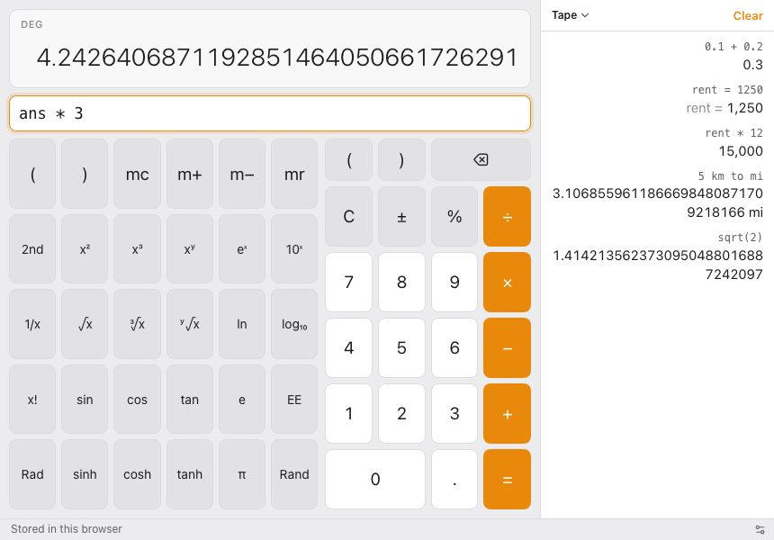

# Abacite

Abacite is a calculator with exact decimal arithmetic, a tape of every calculation, and Basic and Scientific keypads. It runs as a desktop app, in the browser and on the command line, on the same engine.



- **Exact decimals.** `0.1 + 0.2` is `0.3`, to 34 significant digits, with no floating-point noise.
- **Type the whole calculation.** The result shows as you type, and the keypads type into the same line.
- **A tape you keep.** Every calculation goes on the tape, a plain text file saved as you go, ready to bring back with ↑ or a click.

## Getting started

Abacite isn't packaged yet. To run it from source you need Node 22.18 or later, pnpm and [just](https://github.com/casey/just):

```bash
just setup
just run-desktop
```

`just run-web` runs it in the browser, and `just cli "2 * (3 + 4)"` runs the command line.

## Docs

- [Features](docs/features.md)
- [Controls](docs/controls.md)
- [Development](docs/development.md) and [Architecture](docs/architecture.md)

## License

[MIT](LICENSE)
